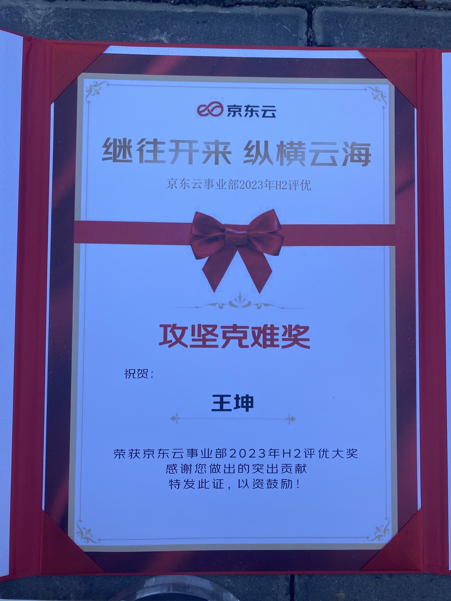
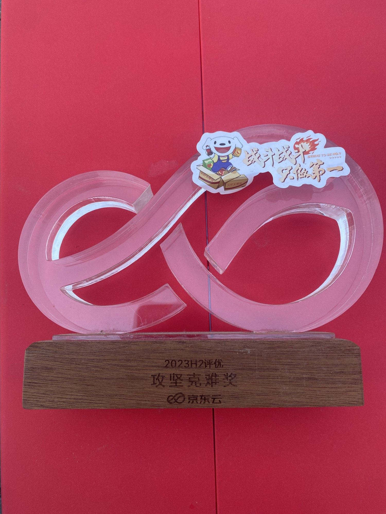
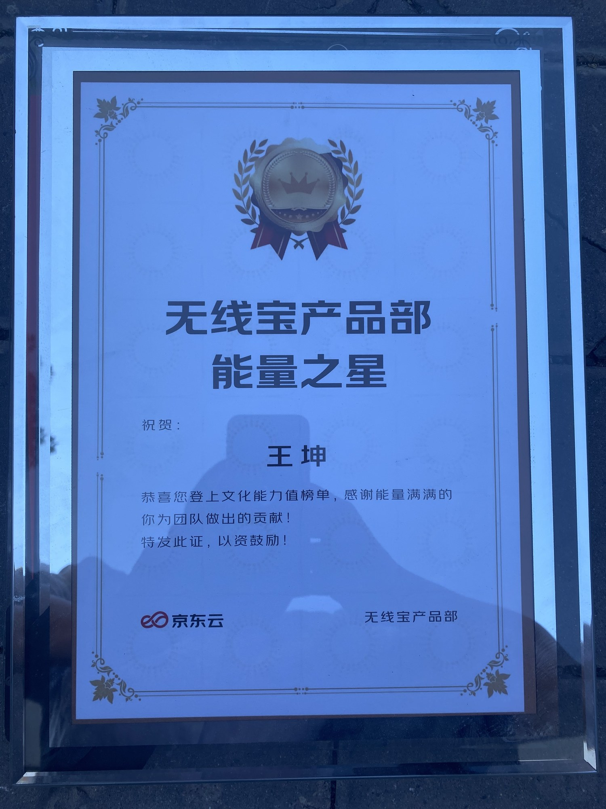

# 荣誉与专利

[返回首页](../README.md) · [查看简历](../resume.md)

## 京东云事业部 2023 年下半年攻坚克难奖

个人奖项，证书与奖杯对应同一次获奖。

## 无线宝产品部 2024 年上半年卓越服务奖

因系统优化工作获得个人奖项。在 AX3000 的 512M 硬件上，通过系统内存布局调整及业务程序优化，支持 PCDN 业务运行并保障用户体验。

[查看系统优化详情](troubleshooting.md#系统内存与-pcdn-业务运行优化)

## 无线宝产品部 2022 年第一季度能量之星

个人奖项。证书载明获奖人王坤、能量之星；获奖季度与年份为本人任职记录。

## 专利申请

作为发明人参与 3 项相关专利申请，目前授权中。专利名称与申请号暂未整理到此仓库。
